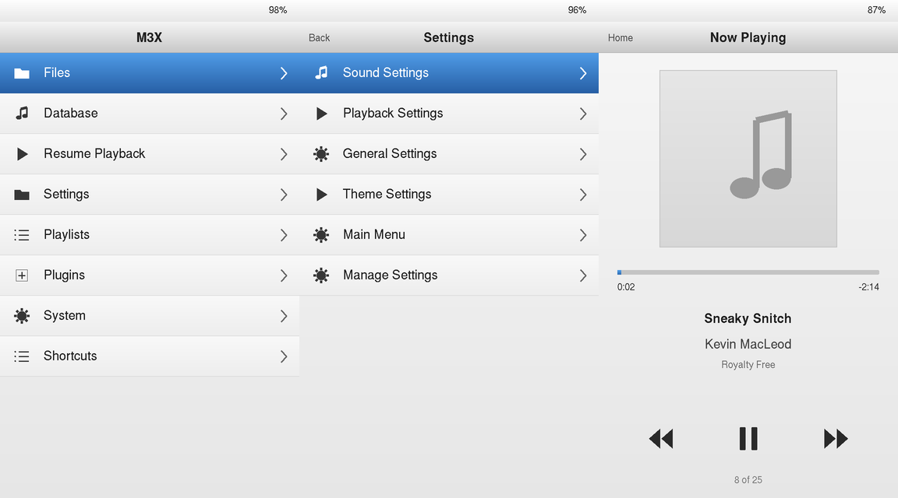

# Rockbox for Shanling M3X

An experimental native ARM64 port of [Rockbox](https://www.rockbox.org/) for the
Shanling M3X. It runs on the player's **existing rooted Android system** and
returns to Android when you finish. It is not an official Rockbox or Shanling
release, a replacement firmware image, or a ZIP to flash in recovery/Magisk.

## Start here

- **Install, update or roll back:** [installation guide](tools/m3x/INSTALL.md).
- **Build or contribute:** [development tools](tools/m3x/README.md) and the build steps below.
- **Understand the hardware limits:** [validation record and remaining checks](M3X_OFFLINE_CHECKLIST.md).
- **Maintenance review:** [Ponytail findings, fixes and verification](docs/PONYTAIL_REVIEW.md).
- **Source and licenses:** [upstream provenance](UPSTREAM.md), [GPLv2](LICENSE) and component notices.

## Requirements and limits

The supported development setup is **Shanling M3X firmware 1.75, Android 7.1.1
(API 25), Magisk root and the existing I2C5 GPIO18/19 device-tree audio fix**.
The installer does not root the player or apply that boot-image fix. Other
firmware versions have not been validated. Back up the player before changing it.

| Area | Recorded device results | Limits |
| --- | --- | --- |
| Interface | 768×1280 touch UI, physical keys, artwork and iPod-style theme | No click wheel or album-thumbnail grid |
| Internal audio | MP3/FLAC playback, prompt volume controls, tested rates from 44.1 to 192 kHz | Output is stereo 16-bit PCM; balanced output, filters and absolute volume calibration need checks |
| USB audio | Apple USB-C EarPods `05ac:110b`, playback and repeated USB/internal switching | Stereo 16-bit/44.1 kHz only; no other USB devices, microphone or headset buttons |
| Pocket mode | Power toggles the dark screen/touch lock; music and physical controls continue | Linux stays awake; whole-system suspend is disabled |
| Storage | Internal storage and a 128 GB FAT32 microSD, MP3/FLAC playback and Android unmount/remount | Card removal during playback and reboot persistence remain unverified; FAT32 files are limited to 4 GiB |
| Recovery | Launch/return, installer update/rollback and Android-default reboot | Physical shutdown, unplugged battery drain, plugins and shuffle/repeat need more testing |

These are prior device observations, not guarantees for every build. Software
progress and underrun counters do not measure analog dropouts. The earlier
status-139 crash did not recur in later recorded runs; its original cause is
still unconfirmed. See the validation record for dates and evidence limits.

## Install and use

Build an installer as described below, or use a matching installer and source
archive supplied by the project maintainer. Extract the installer on your
computer, authorize ADB and Magisk on the M3X, and **return to Android before
installing or updating**. Inside the extracted directory:

```sh
python3 install.py check
python3 install.py install
```

Keep the printed backup path and rollback command. Updates preserve music and
existing settings; rollback restores the saved installation. The
[installation guide](tools/m3x/INSTALL.md) covers device checks, multiple ADB
devices, interrupted updates and restoration. Do not flash the installer ZIP.

1. Tap **Rockbox** in Android and grant Magisk root access. Startup takes about
   20 seconds; a hot device can take longer while it cools. Boot autostart stays
   disabled and a manual session has no duration timer.
2. Start at low volume. Browse **Files → Music** or **Files → microSD**.
3. Briefly press **Power** to lock touch and turn the screen off. Music and
   volume/playback keys remain usable. Press Power again to wake, then lift any
   finger already touching the screen. Touch gestures do not unlock pocket mode.
4. To leave, tap **Home** from Now Playing and choose **Return to Android** at
   the bottom of the main menu. State is saved and audio closes without a reboot.
   A three-second Power hold requests shutdown instead; physical shutdown still
   needs validation.

Choose **Settings → Theme Settings → Browse Themes → m3x-ipod** to select the
included theme. It has Back/Home and previous/play-pause/next touch controls.



Return to Android and eject the microSD card before removing it. The installer
only exposes Android's mounted card; it never formats it.

## Build from source

Run commands from this project's root. The native build needs **Android NDK
r17c**, its ARM64 GCC 4.9 toolchain and API 24, plus Python 3.9+, Perl, Make,
a host C compiler and zip/unzip. A modern Clang-only NDK is not a drop-in
replacement. On Apple silicon the NDK's x86_64 tools require Rosetta.

```sh
export ANDROID_NDK_PATH=/absolute/path/to/android-ndk-r17c
mkdir -p build-m3x
cd build-m3x
../rockbox/tools/configure --target=shanlingm3x --type=n --no-ccache
make -j4
make zip
cd ..
sh tools/m3x/verify-offline.sh
```

The executable is `build-m3x/rockbox`; matching assets, codecs and plugins are
in `build-m3x/rockbox.zip`. **Never mix binaries and modules from different
builds.** Offline verification does not connect to or modify a player. It also
creates `build-m3x/m3x-offline-bundle.zip` for manual development updates, not
standalone installation.

To create the standalone installer, build the Android launcher with a JDK and
Android SDK ([launcher prerequisites](android-launcher/README.md)):

```sh
python3 tools/m3x/build-android-launcher.py --sdk /absolute/path/to/android-sdk
python3 tools/m3x/package-installer.py
```

Installer and corresponding-source ZIPs appear in `build-m3x/release/`.
Keep `build-m3x-launcher/launcher-signing.jks` private and backed up: APK updates
need the same signing identity. Distribute the matching source archive alongside
the installer. Packaging fixes ZIP order, timestamps and modes; it does not claim
identical binaries across different compilers or signing keys.

## Test without the player

The host driver and launcher replays need Python and a C compiler; they do not
need ADB. The complete suite also checks existing ARM64 build outputs and skips
private boot-image checks when their fixtures are absent:

```sh
python3 -m unittest discover -s tools/m3x/tests -v
```

For an actual desktop UI and MP3-decoding smoke run, build the simulator on macOS
with SDL2 and pkg-config installed:

On Apple silicon with Homebrew, put `/opt/homebrew/bin` first in `PATH` so
`pkg-config` uses the installed SDL2 and theme tools use the Python with Pillow:
`export PATH=/opt/homebrew/bin:$PATH`. The theme preview also requires Pillow.

```sh
mkdir -p build-m3x-sim
cd build-m3x-sim
../rockbox/tools/configure --target=shanlingm3x --type=s --sdl-threads --no-ccache
make -j4
make install
mkdir -p simdisk/.rockbox/fonts
../rockbox/tools/convbdf -f -o simdisk/.rockbox/fonts/35-Adobe-Helvetica.fnt \
    ../rockbox/fonts/35-Adobe-Helvetica.bdf
cd ..
python3 tools/m3x/run-simulator-test.py
```

The automated simulator smoke uses macOS dynamic-library injection, a temporary
filesystem and file-only audio. It does not prove the physical DAC or Android
linker works. Theme preview and hardware probes are in the
[tool guide](tools/m3x/README.md); never deploy probes or flash images as part of
routine host testing.

## Workspace layout

| Path | Purpose |
| --- | --- |
| `rockbox/` | Upstream Rockbox source plus the M3X target and theme assets; its Git history is retained locally |
| `m3x-module/` | Current manual-session, takeover and Android-recovery scripts |
| `android-launcher/` | Android launch icon source |
| `tools/m3x/` | Build/packaging tools, diagnostics and regression replays |
| `docs/`, `M3X_OFFLINE_CHECKLIST.md` | Public images and validation record |
| `media/` | Licensed test MP3 and attribution |
| `build-m3x/`, `build-m3x-sim/`, `build-m3x-launcher/` | Generated work directories; the launcher directory also holds the private signing key |
| `local/` | Private device dumps, validation captures, backups, firmware, kernel research, unused toolchains and archived prototypes; excluded from source distribution |
| `publish/` | Local export snapshot, not a second development tree; edit the root sources |

Keep active build and NDK directories in place: generated Makefiles contain
absolute paths. For a relocated checkout, reconfigure the builds instead of
copying those Makefiles. Do not delete `local/` as if it were a cache: it contains
recovery material and evidence. Historical notes under `local/notes/` describe
older directory locations.

AI tools assisted development. Validation limits are stated above rather than
claiming that generated code or host tests establish hardware safety.
